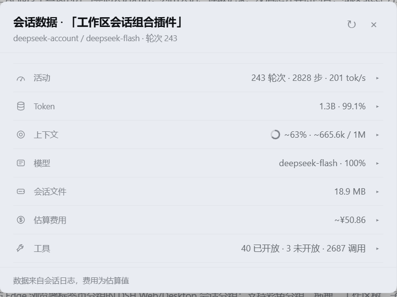
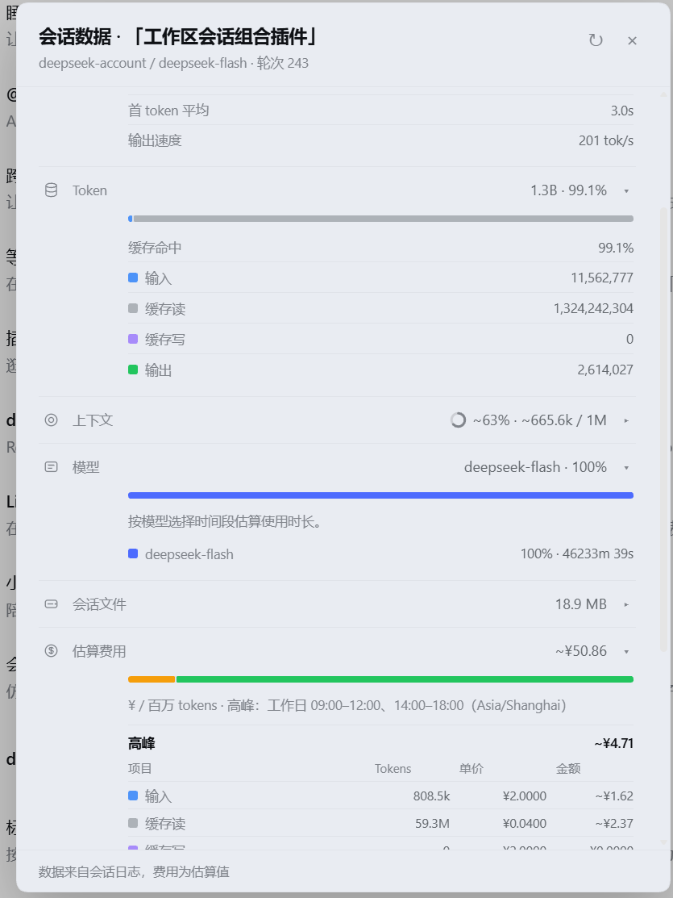

# DSH Session Groups Data

`dsh-session-groups` 的可选数据面板扩展。当前版本 `0.1.1`。

它负责会话 / 组 / 工作区的 Token、上下文、模型、会话文件、费用和工具统计，
以及高峰 / 空闲价格设置和独立的 Host 数据接口。它不渲染、也不替换侧栏。

## 中文

### 界面

<p align="center">
  
</p>
<p align="center"><sub>汇总视图：活动、Token、上下文、模型、会话文件、估算费用和工具；每行可展开。</sub></p>

<p align="center">
  
</p>
<p align="center"><sub>展开视图：Token 构成、模型使用时长，以及高峰 / 空闲费用明细。</sub></p>

### 面板内容

- **活动**：轮次、步数、平均首 token、输出速度
- **Token**：总 Token、缓存命中率、输入 / 缓存读 / 缓存写 / 输出
- **上下文**：当前上下文占用环和已用 / 窗口大小
- **模型**：模型使用时长和占比
- **会话文件**：压缩会话日志大小和事件数
- **估算费用**：高峰 / 空闲价格、各 Token 项单价和金额
- **工具**：开放 / 未开放工具数、调用次数

数据来自会话日志和当前 Host；费用是估算值，不是账单。

### 依赖

- DSH `>=0.2.1-rc.2 <0.3.0`
- 必须先安装 [`dsh-session-groups`](https://github.com/xyzYaeMiko/dsh-session-groups) `>=0.7.1`

只安装本插件不会生效。数据菜单只有在核心插件提供
`sessionGroupsUI` 服务后才会出现。

### 安装

先安装核心插件，再通过 DSH 插件管理器选择本仓库/目录，或执行：

```bash
dsh plugin install https://github.com/xyzYaeMiko/dsh-session-groups-data
```

### 功能

- 会话 / 组 / 工作区数据面板
- 数据面板内部滚动，滚轮不影响会话栏
- Token、缓存命中、上下文、模型、文件、费用、工具统计
- 高峰 / 空闲两套人民币价格
- 法定节假日
- 独立 Host 路由：

```text
/dsh-session-groups-data-bridge/data
```

### 注意

- 核心插件必须先安装并启用
- 升级核心或本插件后，需要完整重启一次 DSH Host
- 仅刷新页面只更新 Client，不会更新 Host 路由

## English

Optional data-panel extension for
[`dsh-session-groups`](https://github.com/xyzYaeMiko/dsh-session-groups).

See `docs/data-overview.png` and `docs/data-expanded.png` for the collapsed and
expanded data panel.

It contributes the session/group/workspace data view (tokens, context, model,
file, cost and tool statistics), peak/off-peak pricing settings, and its own
Host data bridge. It does not render or replace the sidebar.

### Requirements

- DSH `>=0.2.1-rc.2 <0.3.0`
- `dsh-session-groups >=0.7.1` installed first

Install the core plugin, then this extension. The data menu is hidden while the
core service is absent.

### Install

```bash
dsh plugin install https://github.com/xyzYaeMiko/dsh-session-groups-data
```

### What it contributes

- `sessionGroupsUI` data provider (`protocol: 1`)
- a `shell.overlay` data panel
- a `settings.section` page for peak/off-peak pricing
- Host route `/dsh-session-groups-data-bridge/data`

The Host route and core `/data` removal need a full DSH Host restart after
upgrade; refreshing the browser alone only reloads the Client.
